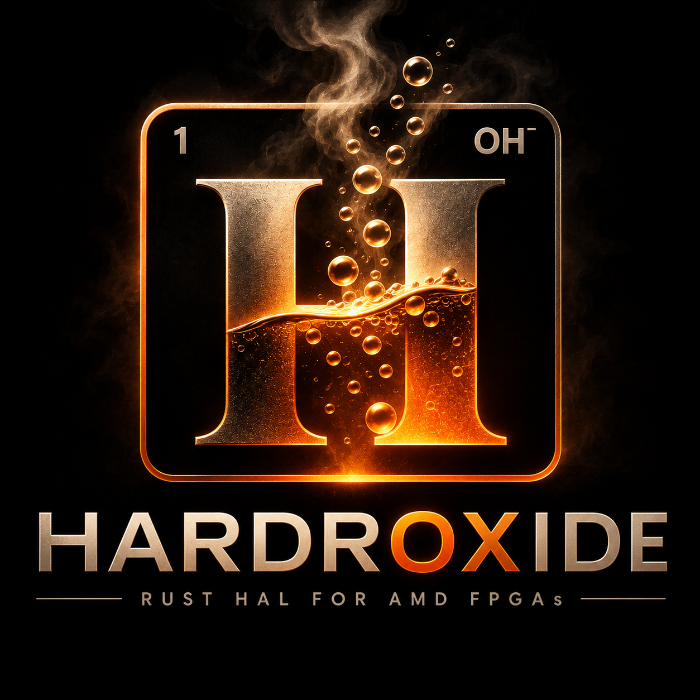

<p align="center">
  
</p>

# Hardroxide

Rust HAL generator and runtime for AMD FPGAs: turn a Vivado XSA into a typed
Rust crate, a Rust counterpart to the PYNQ overlay framework.

```
hardroxide generate design.xsa -o my_design
```

Documentation (user guide, API reference, design docs):
https://jwkunz.github.io/Hardroxide/ (once GitHub Pages is enabled), or build
it locally with `mdbook build` (output in `target/book`).

Status: hardware-free development is complete through Milestone 5 (GPIO, HLS,
DMA, Timer, IIC, SPI); nothing has been validated on a board yet. See
[`docs/`](docs/design-index.md), especially
[`docs/08-verification-gaps.md`](docs/08-verification-gaps.md).

## License

Copyright (c) 2026 Numerius Engineering LLC. Licensed under either of
[Apache License, Version 2.0](LICENSE-APACHE) or [MIT license](LICENSE-MIT) at
your option. Contact: numerius.engineering@gmail.com.

Unless you explicitly state otherwise, any contribution intentionally submitted
for inclusion in this project, as defined in the Apache-2.0 license, shall be
dual licensed as above, without any additional terms or conditions.
