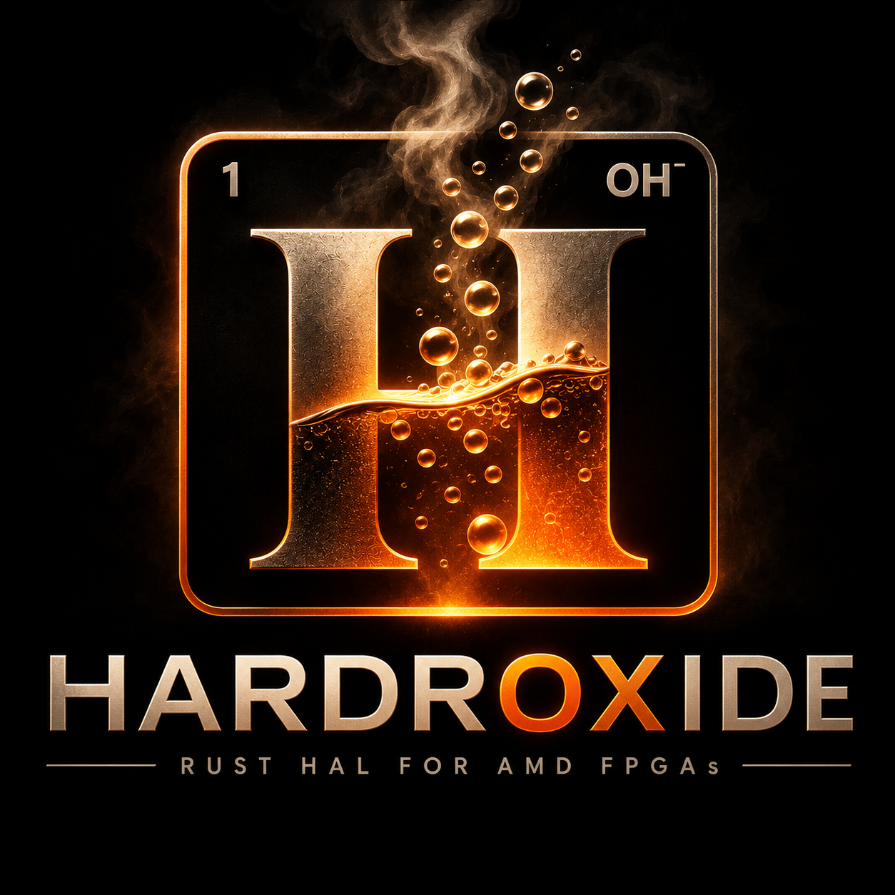

<p align="center">
  
</p>

# Hardroxide

Hardroxide turns a Vivado **XSA** (bitstream plus hardware handoff) into a
typed **Rust HAL crate**: a Rust counterpart to the PYNQ overlay framework.

```text
design.xsa --> hardroxide generate --> my_design/ (Cargo crate)
                                         |- bitstream/design.bin   (embedded)
                                         |- src/pac.rs             (registers, interrupt lines)
                                         |- src/lib.rs             (Design, load())
                                         |- src/ips.rs             (HLS kernel wrappers)
                                         |- interrupts.dtso        (UIO overlay)
                                         `- examples/              (board checks)
```

With the generated crate, using the FPGA design is ordinary Rust:

```rust,ignore
let d = my_design::Design::load()?;          // program the PL, set clocks, map the IP
d.axi_gpio_0.write(Channel::One, 0b1010)?;   // a typed driver per IP instance
d.vadd_0.set_a(40)?;                          // named registers for HLS kernels
d.vadd_0.start()?;
```

Every IP instance in the block design is a typed field, every register offset
and bit field is a constant, and the bitstream travels inside your binary.

First target: PYNQ-Z2 (Zynq-7000, ARMv7) with Vivado 2025.2, running under the
stock PYNQ Linux image. The runtime lives in Linux userspace on the PS and
manages the PL only.

## How this book is organised

- **User Guide**: install, generate, use and update a crate. New readers:
  [Getting started](guide/getting-started.md), then
  [How it works](guide/concepts.md).
- **Reference**: the authoritative description of the CLI, the generated
  crate, and every public runtime crate. Function signatures in the reference
  chapters are checked against the source by the test suite, and the CLI help
  text against the real `--help` output, so they cannot silently drift. Rustdoc
  (`cargo doc`, published under [`api/`](api/hardroxide_hwh/index.html)) is
  the generated companion for exhaustive type listings.
- **Design**: the specifications and decision records behind the project.
- **Status**: what real Vivado output looks like (*HWH findings*) and what has
  **not** yet been verified on hardware (*Verification gaps*).

> **Hardware status.** Generation, bitstream loading, clocks, interrupts and
> drivers for GPIO, HLS (scalar and pointer arguments), DMA, Timer, IIC, SPI,
> the AXI interrupt controller, BRAM, UART Lite and the AXI4-Stream FIFO are
> implemented and tested without a board: mock MMIO, golden snapshots,
> register maps checked against real Vivado 2025.2 output, and the runtime
> tests run as 32-bit ARM binaries under emulation. Nothing has been validated
> on a PYNQ-Z2 yet. Read [Verification gaps](08-verification-gaps.md) before
> trusting any driver on real hardware.

## Crates

| Crate | Role |
|---|---|
| [`hardroxide-hwh`](reference/hwh.md) | Parse XSA / HWH into a typed design model |
| [`hardroxide-gen`](reference/gen.md) | Generate and update the HAL crate |
| [`hardroxide-mmio`](reference/mmio.md) | MMIO backends: `/dev/mem`, UIO, mock |
| [`hardroxide-fpga`](reference/fpga.md) | Bitstream loading and PL clocks |
| [`hardroxide-dma`](reference/dma.md) | DMA buffers (`DmaBuffer`, udmabuf) |
| [`hardroxide-irq`](reference/irq.md) | UIO interrupt waiting, blocking and async |
| [`hardroxide-ip`](reference/ip.md) | Drivers: GPIO, HLS, DMA, Timer, IIC, SPI, interrupt controller, BRAM, UART Lite, AXI4-Stream FIFO |
| `hardroxide-cli` | The `hardroxide` binary ([CLI](reference/cli.md)) |

License: MIT OR Apache-2.0 (see `LICENSE-MIT`, `LICENSE-APACHE`). Copyright (c) 2026 Numerius Engineering LLC.
