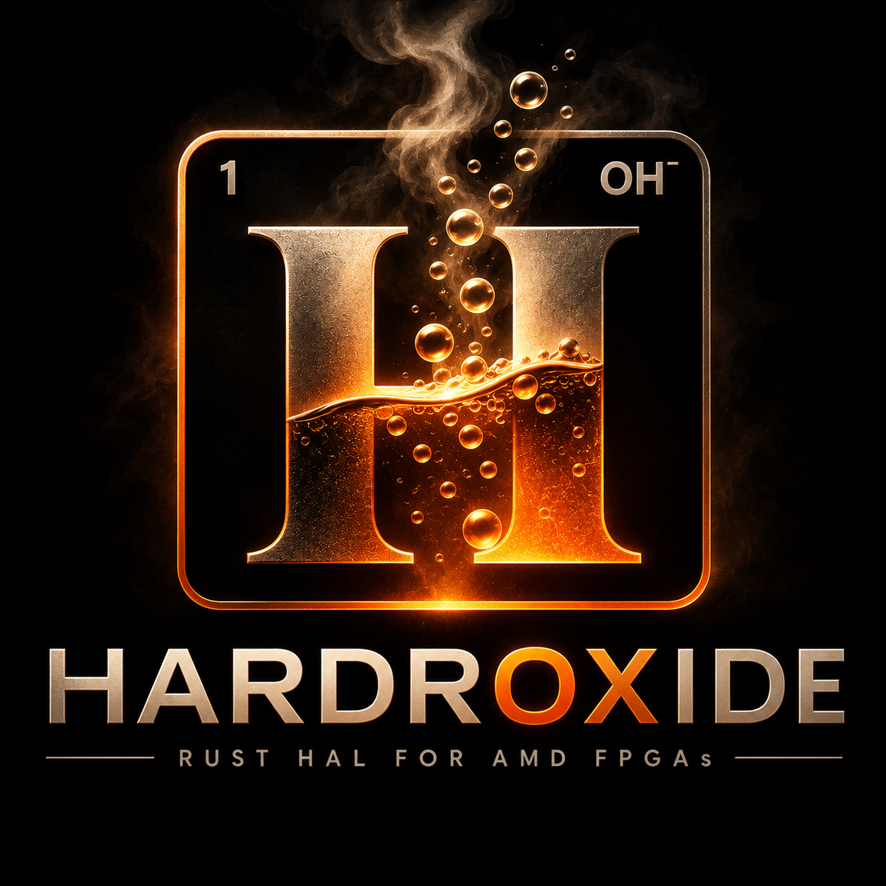

<p align="center">
  
</p>

# Hardroxide

Hardroxide turns a Vivado **XSA** (bitstream plus hardware handoff) into a
typed **Rust HAL crate**: a Rust counterpart to the PYNQ overlay framework.

```text
design.xsa --> hardroxide generate --> my_design/ (Cargo crate)
                                         |- bitstream/design.bin   (embedded)
                                         |- src/pac.rs             (registers, interrupt lines)
                                         |- src/lib.rs             (Design, load())
                                         |- src/ips.rs             (HLS kernel wrappers)
                                         |- interrupts.dtso        (UIO overlay)
                                         `- examples/              (board checks)
```

With the generated crate, using the FPGA design is ordinary Rust:

```rust,ignore
let d = my_design::Design::load()?;          // program the PL, set clocks, map the IP
d.axi_gpio_0.write(Channel::One, 0b1010)?;   // a typed driver per IP instance
d.vadd_0.set_a(40)?;                          // named registers for HLS kernels
d.vadd_0.start()?;
```

Every IP instance in the block design is a typed field, every register offset
and bit field is a constant, and the bitstream travels inside your binary.

First target: PYNQ-Z2 (Zynq-7000, ARMv7) with Vivado 2025.2. One XSA, three **flavors** of generated crate
(`hardroxide generate --platform ...`):

| Flavor | Your program is | Details |
|---|---|---|
| **Linux** (default) | a process under the stock PYNQ Linux image; Linux owns the PS, Hardroxide manages the PL | [Running on hardware](guide/hardware.md) |
| **Bare metal** | the only software on core 0, with startup, interrupts, timers, UART, MMU and caches from `hardroxide-ps7`, started over JTAG or from SD | [Running bare metal and RTOS](guide/baremetal.md) |
| **RTOS** | bare metal plus the `hardroxide-rt` kernel: priority-preemptive tasks, semaphores, mutexes, queues, 10 ms control loops | [Kernel reference](reference/rt.md) |

The register layer, the typed drivers and the `Design` type are the same in all three
([choosing a flavor](guide/workflow.md#choosing-a-flavor)).

## Where to start

| You want to | Go to |
|---|---|
| see it work, step by step, with real output | [Tutorials](tutorials/index.md), by flavor: eleven for Linux (LEDs to DMA to a 70-IP third-party design), then three for bare metal and one for the RTOS |
| decide between Linux, bare metal and RTOS | [Choosing a flavor](guide/workflow.md#choosing-a-flavor) |
| understand the whole flow in one page | [The workflow](guide/workflow.md) |
| use your own Vivado design | [Exporting an XSA from Vivado](guide/vivado.md), then [The workflow](guide/workflow.md) |
| install the tool and the toolchain | [Getting started](guide/getting-started.md) |
| look up an API, the CLI or a driver | [Reference](reference/cli.md) |
| know what has been verified on hardware | [Verification gaps](08-verification-gaps.md) |

## How this book is organised

- **User Guide**: install, generate, use and update a crate; the workflow, and how
  to prepare a board.
- **Tutorials**: twenty-one hands-on walk-throughs grouped by flavor (eleven Linux, three bare metal, one RTOS, six applications), each on
  one of the test designs in `fixtures/`, with output captured on a PYNQ-Z2.
- **Reference**: the authoritative description of the CLI, the generated crate, the
  board scripts and every public runtime crate. Function signatures in the reference
  chapters are checked against the source by the test suite, and the CLI help text
  against the real `--help` output, so they cannot silently drift. Rustdoc
  (`cargo doc`, published under [`api/`](api/hardroxide_hwh/index.html)) is the
  generated companion for exhaustive type listings.
- **Design**: the specifications and decision records behind the project.
- **Status**: what real Vivado output looks like (*HWH findings*) and what has and
  has not been verified on hardware (*Verification gaps*).

> **Hardware status.** Linux: generation, bitstream loading, clocks, interrupts and
> the drivers for GPIO, HLS (scalar and pointer arguments), DMA, Timer, IIC, SPI,
> the AXI interrupt controller, BRAM, UART Lite and the AXI4-Stream FIFO have been run
> on a PYNQ-Z2, as has a crate generated from the PYNQ base overlay. Hardware testing
> found and fixed several driver bugs and one generator bug, and turned up one
> unexplained platform problem (a wedged HP port after many design switches, [G17](08-verification-gaps.md));
> everything is recorded in [Verification gaps](08-verification-gaps.md). Zynq-7000
> only; Vivado 2025.2 is the version exercised on hardware. Bare metal and RTOS (new in 2.0): the PS support
> crate, the kernel, the MMU and caches, the generated crates, `hardroxide run` and DMA have been run on a PYNQ-Z2 and
> under QEMU; booting a `hardroxide package` image from SD has not been tried on hardware yet.

## Crates

| Crate | Role |
|---|---|
| [`hardroxide-hwh`](reference/hwh.md) | Parse XSA / HWH into a typed design model |
| [`hardroxide-gen`](reference/gen.md) | Generate and update the HAL crate |
| [`hardroxide-mmio`](reference/mmio.md) | MMIO backends: `/dev/mem`, UIO, mock |
| [`hardroxide-fpga`](reference/fpga.md) | Bitstream loading and PL clocks |
| [`hardroxide-dma`](reference/dma.md) | DMA buffers (`DmaBuffer`, udmabuf) |
| [`hardroxide-irq`](reference/irq.md) | UIO interrupt waiting, blocking and async |
| [`hardroxide-ps7`](reference/ps7.md) | Zynq-7000 bare-metal support: startup, GIC, timers, UART, MMU and caches |
| [`hardroxide-rt`](reference/rt.md) | Real-time kernel for the Cortex-A9 |
| [`hardroxide-video`](reference/video.md) | HDMI output for the PYNQ base overlay: modes and bring-up |
| [`hardroxide-gfx`](reference/gfx.md) | A small 2D graphics library over a pixel buffer |
| [`hardroxide-audio`](reference/audio.md) | Audio for the base overlay: the ADAU1761 codec, WAV, tones, playback and recording |
| [`hardroxide-ip`](reference/ip.md) | Drivers: GPIO, HLS, DMA, Timer, IIC, SPI, interrupt controller, BRAM, UART Lite, AXI4-Stream FIFO |
| `hardroxide-cli` | The `hardroxide` binary ([CLI](reference/cli.md)) |

License: MIT OR Apache-2.0 (see `LICENSE-MIT`, `LICENSE-APACHE`). Copyright (c) 2026 Numerius Engineering LLC.
